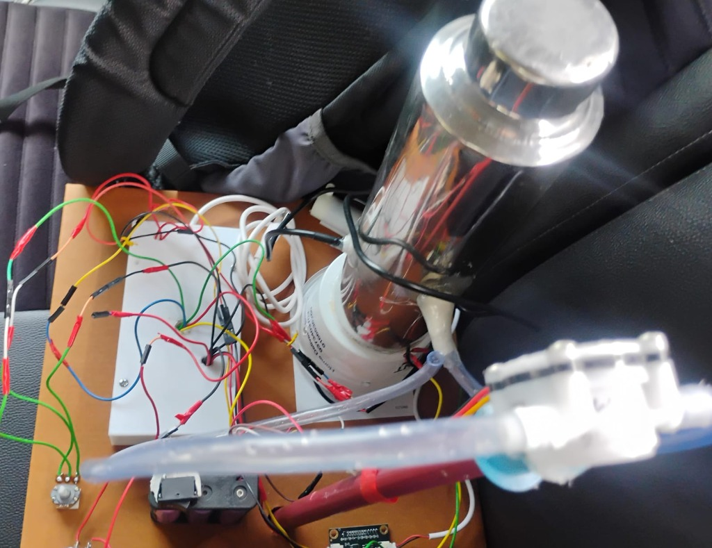
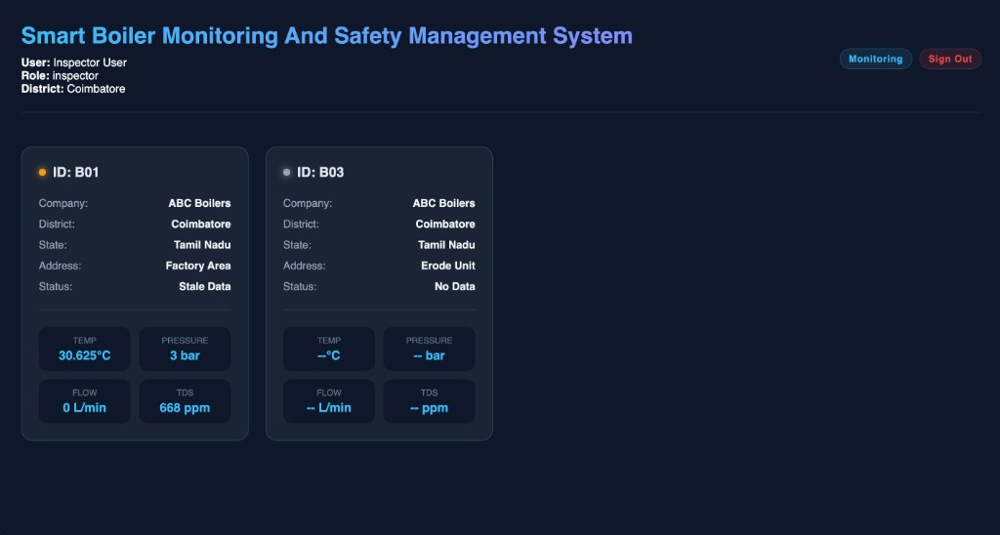
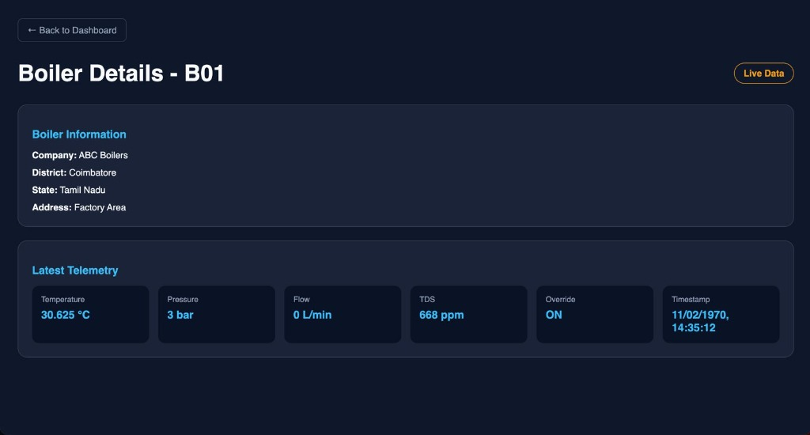
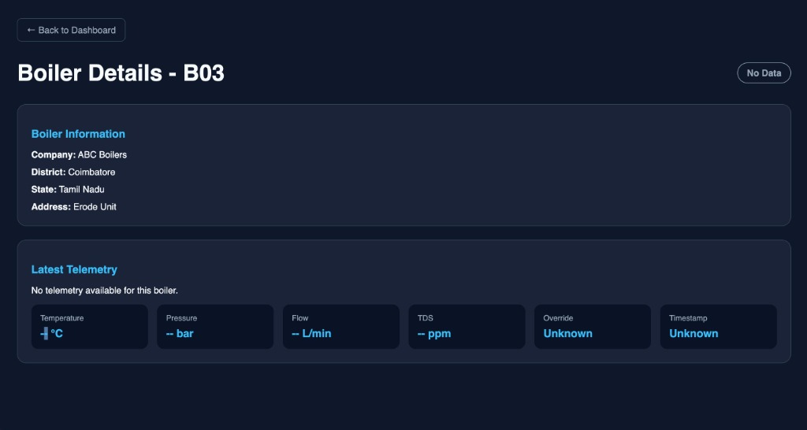

# Smart Boiler Monitoring and Safety Management System

An industrial IoT-based system that monitors boiler parameters in real time (temperature, pressure, flow rate, and TDS), provides automated safety state classification, and visualizes live telemetry through a role-based web dashboard.

---

## 📸 System Showcase

### Hardware Prototype Setup
Physical testing rig featuring the boiler cylindrical vessel, temperature & pressure probes, water flow sensor, ESP32 microcontroller, and power distribution board.



### Web Dashboard & Telemetry Monitoring
Modern React web dashboard featuring role-scoped access control (Inspector / Owner / Admin), multi-boiler grid monitoring, real-time alerts, and detailed telemetry breakdown.

#### Multi-Boiler Overview


#### Boiler Details & Real-Time Telemetry
| Live Telemetry (Boiler B01) | Offline / Standby State (Boiler B03) |
| :---: | :---: |
|  |  |

---

## 📌 Project Overview

Industrial boilers operate under high temperatures and pressures, making continuous monitoring essential for workplace safety and operational efficiency.  
This project implements an end-to-end **Smart Boiler Monitoring and Safety Management System** combining embedded IoT hardware, secure cloud messaging over TLS, a Node.js ingestion bridge, Cloud Firestore database, and a responsive web dashboard.

The system continuously collects and monitors:
- **Temperature** (°C)
- **Pressure** (bar)
- **Flow Rate** (L/min)
- **Total Dissolved Solids (TDS)** (ppm)
- **Manual Override Status** (ON / OFF)

Boiler operational safety states are classified in real time:
- 🟢 **NORMAL**
- 🟡 **WARNING**
- 🔴 **DANGER**

---

## 🛠️ System Architecture

```text
[ Physical Boiler & Sensors ]
              │
              ▼
    [ ESP32 Microcontroller ]
              │  (MQTT over TLS 8883)
              ▼
     [ HiveMQ Cloud Broker ]
              │
              ▼
   [ Node.js Ingestion Bridge ]
              │
              ▼
     [ Firebase Firestore ]
              │  (Realtime sync / Auth)
              ▼
 [ React + Vite Web Dashboard ] (Inspector / Owner / Admin)
```

1. **ESP32 Microcontroller** samples sensor readings (temperature, pressure, flow rate, TDS).
2. **HiveMQ Cloud** receives encrypted telemetry payloads published via MQTT over TLS.
3. **Node.js Ingestion Bridge** validates topics and payloads, verifies registered boilers, and streams records into Google Cloud Firestore.
4. **React Dashboard** provides role-scoped real-time telemetry inspection, stale data detection, and manual override controls.

---

## ⚙️ Technologies Used

### Hardware Components
- **ESP32 Dev Board** (32-bit dual-core MCU with Wi-Fi & Bluetooth)
- **Temperature Sensor** (DS18B20 digital temperature probe)
- **Pressure Transducer Sensor**
- **Water Flow Sensor** (Hall-effect turbine sensor)
- **TDS Sensor** (Water quality monitoring)
- **Power Supply / Battery Pack**

### Software & Cloud Stack
- **Dashboard Frontend**: React 18, Vite, Vanilla CSS / Tailwind utilities
- **Ingestion Bridge**: Node.js 22, `firebase-admin`, `mqtt.js`
- **Cloud & Database**: Google Firebase Authentication, Cloud Firestore
- **IoT Messaging**: HiveMQ Cloud (MQTT over TLS, port 8883)
- **Firmware**: C++ / Arduino IDE, `PubSubClient`, `WiFiClientSecure`

---

## 📁 Repository Structure

```text
Boiler-Black-Box/
├── README.md                                  # Project overview and documentation
├── .gitignore                                 # Git ignore rules for node_modules and secrets
├── docs/
│   └── images/                                # Project screenshots and prototype images
│       ├── hardware-prototype.jpg
│       ├── dashboard-overview.jpg
│       ├── boiler-details-live.jpg
│       └── boiler-details-nodata.jpg
├── Boiler Dash HW component and code/         # Embedded firmware and legacy dashboard
│   ├── arduinoesp32.ino                       # ESP32 Arduino firmware sketch
│   ├── Certificates.h                         # TLS Root CA certificate for HiveMQ
│   └── dashboard.html                         # Standalone HTML dashboard
└── Boiler Web 1.0/                            # Production Web Application
    ├── package.json                           # Root workspace npm scripts
    ├── firebase.json                          # Firebase hosting and emulator config
    ├── firestore.rules                        # Role-based Firestore security rules
    ├── firestore.indexes.json                 # Firestore composite indexes
    ├── boiler-dashboard/                      # React + Vite frontend
    │   ├── src/                               # Application source code
    │   │   ├── pages/                         # Dashboard, BoilerDetail, Login
    │   │   ├── lib/                           # Firebase Auth, data helpers, live state
    │   │   └── App.jsx                        # Main application component
    │   ├── package.json
    │   └── vite.config.js
    └── boiler-mqtt-bridge/                    # Node.js MQTT-to-Firestore bridge
        ├── index.js                           # Bridge entrypoint and MQTT subscriber
        ├── firebase.js                        # Firebase Admin SDK initialization
        ├── payload.js                         # Telemetry payload schema validation
        ├── check_db.js                        # Database connectivity check script
        ├── create_users.js                    # Script to provision Auth users & profiles
        ├── migrate_profiles.js                # Profile migration utility
        ├── .env.example                       # Example environment configuration
        └── package.json
```

---

## 🚀 How to Run Locally

### 1. Prerequisites
Ensure you have installed:
- **Node.js** `v22.12` or newer (`node -v`)
- **npm** `v10` or newer (`npm -v`)
- **Arduino IDE** (if flashing ESP32 hardware)

---

### 2. Install Dependencies

From the repository root, install dependencies for both the frontend dashboard and the backend MQTT bridge:

```bash
# Navigate to the web application directory
cd "Boiler Web 1.0"

# Install dashboard dependencies
npm --prefix boiler-dashboard install

# Install MQTT bridge dependencies
npm --prefix boiler-mqtt-bridge install
```

---

### 3. Configure Environment Variables

The MQTT bridge requires HiveMQ broker credentials and Firebase Admin credentials.

1. Create a `.env` file in `Boiler Web 1.0/boiler-mqtt-bridge/`:
   ```bash
   cp boiler-mqtt-bridge/.env.example boiler-mqtt-bridge/.env
   ```
2. Edit `boiler-mqtt-bridge/.env` with your actual credentials:
   ```env
   MQTT_HOST=mqtts://your-broker-host.hivemq.cloud:8883
   MQTT_USER=your-mqtt-username
   MQTT_PASS=your-mqtt-password
   GOOGLE_APPLICATION_CREDENTIALS=./your-service-account-key.json
   ```
   *(Keep service-account keys and `.env` files confidential. They are ignored by `.gitignore`.)*

---

### 4. Run the Web Dashboard

Start the React development server:

```bash
# From Boiler Web 1.0 directory:
npm run dev

# Or directly from boiler-dashboard:
# cd boiler-dashboard && npm run dev
```

The dashboard will be available at:
👉 **`http://localhost:5173`**

Log in using your registered credentials (e.g., Inspector, Owner, or Admin account).

---

### 5. Run the MQTT Ingestion Bridge

In a separate terminal window, launch the Node.js bridge to ingest live telemetry from the MQTT broker into Firestore:

```bash
# From Boiler Web 1.0 directory:
npm run bridge

# Or directly from boiler-mqtt-bridge:
# cd boiler-mqtt-bridge && npm start
```

---

### 6. Run Tests & Validation

Run unit tests and linters across the web stack:

```bash
# Run all tests (dashboard + bridge)
npm test

# Run ESLint code quality checks
npm run lint

# Build the production frontend bundle
npm run build
```
The compiled production bundle will be generated in `boiler-dashboard/dist/`.

---

### 7. Run the ESP32 Hardware Firmware

1. Launch **Arduino IDE**.
2. Install required libraries via Library Manager:
   - `PubSubClient` (by Nick O'Leary)
   - `WiFi` & `WiFiClientSecure` (built-in with ESP32 board package)
3. Open `Boiler Dash HW component and code/arduinoesp32.ino`.
4. Update the Wi-Fi credentials:
   ```cpp
   const char* ssid = "YOUR_WIFI_SSID";
   const char* password = "YOUR_WIFI_PASSWORD";
   ```
5. Update your HiveMQ broker URL and credentials.
6. Select your ESP32 board and COM port, then click **Upload**.

---

### 8. (Optional) Run Legacy Standalone HTML Dashboard

To test the quick-start static dashboard without running the Node.js stack:
1. Open `Boiler Dash HW component and code/dashboard.html` in any web browser.
2. Enter your HiveMQ credentials when prompted to subscribe directly via WebSocket.

---

## 📡 MQTT Topic & Payload Contract

### Topic Formats
- Telemetry: `boiler/{boiler_id}/telemetry`
- Manual Override: `boiler/{boiler_id}/override`

### Example Telemetry Payload
```json
{
  "temperature_c": 30.625,
  "pressure_bar": 3.0,
  "flow_lpm": 0.0,
  "tds_ppm": 668,
  "device_status": "online",
  "override": true,
  "timestamp": 1729329312000
}
```

---

## 🚨 Safety Logic & Thresholds

| Condition | Boiler Status | Action / Indication |
|---|---|---|
| Temperature ≤ 200°C AND Pressure ≤ 6 bar | 🟢 **NORMAL** | Standard continuous operation |
| Temperature > 200°C OR Pressure > 6 bar | 🟡 **WARNING** | Alert operators; inspect cooling & pressure relief |
| Temperature > 220°C OR Pressure > 8 bar | 🔴 **DANGER** | Immediate emergency shutoff & alarm activation |

---

## 🔐 Security & Access Control

- **End-to-End Encryption**: MQTT traffic encrypted via TLS (port 8883) with Root CA validation (`Certificates.h`).
- **Role-Based Access Control (RBAC)**:
  - **Admin**: System-wide access to all boiler units.
  - **Inspector**: Filtered view scoped to their assigned district.
  - **Owner**: Filtered view scoped to their company boilers.
- **Credential Protection**: Firebase service account private keys and broker secrets are decoupled from Git history using environment variables and `.gitignore`.

---

## 👨‍💻 Author

**Akshay**  
Electronics and Communication Engineering  
IoT & Embedded Systems Project  

---

## 📜 License

This project is open-source and free to use for academic and educational purposes.
